# Franklin feature plans

One plan per gnuton/Merlin feature. Each plan explains what the feature
does, how gnuton implements it, which modes it works in, what Franklin
needs to recreate it, and what has been tested/verified.

Each feature is **separable**: it declares `Required` and its
`Dependencies` (links), so removing one feature does not break the
others as long as no remaining feature depends on it. A machine-readable
catalog is in [`manifest.json`](manifest.json) and the planner is
`tools/franklin-build.py`.

Status: `tested` = verified on the XT9; `stock` = handled by stock
firmware; `modular`/`planned` = buildable/planned; `research` =
needs investigation; `out-of-scope` = firmware-level only.

| Feature | Kind | Category | Modes | Status | Required | Requires | Plan |
|---|---|---|---|---|---|---|---|
| Web UI (gnuton httpd + /www) | gnuton-feature | UI | all (AP / Router / Mesh) | `tested` | no | [boot-hook](../features/boot-hook.md) | [web-ui](web-ui.md) |
| VPN Director | gnuton-feature | VPN | Router (needs WAN + routing) | `planned` | no | [firewall-custom](../features/firewall-custom.md), [boot-hook](../features/boot-hook.md) | [vpn-director](vpn-director.md) |
| VPN Killswitch | gnuton-feature | VPN | Router (WAN + VPN client) | `planned` | no | [firewall-custom](../features/firewall-custom.md), [boot-hook](../features/boot-hook.md) | [vpn-killswitch](vpn-killswitch.md) |
| OpenVPN Client | gnuton-feature | VPN | Router (WAN + VPN client) | `stock+` | no | [boot-hook](../features/boot-hook.md) | [openvpn-client](openvpn-client.md) |
| OpenVPN Server | gnuton-feature | VPN | Router | `stock+` | no | [boot-hook](../features/boot-hook.md), [firewall-custom](../features/firewall-custom.md) | [openvpn-server](openvpn-server.md) |
| WireGuard Client | gnuton-feature | VPN | Router | `stock+` | no | [boot-hook](../features/boot-hook.md) | [wireguard-client](wireguard-client.md) |
| WireGuard Server | gnuton-feature | VPN | Router | `stock+` | no | [boot-hook](../features/boot-hook.md), [firewall-custom](../features/firewall-custom.md) | [wireguard-server](wireguard-server.md) |
| IPSec VPN | gnuton-feature | VPN | Router | `stock+` | no | [boot-hook](../features/boot-hook.md), [firewall-custom](../features/firewall-custom.md) | [ipsec-vpn](ipsec-vpn.md) |
| DNS Director (DNSFilter) | gnuton-feature | DNS | Router (DHCP/DNS server) | `planned` | no | [firewall-custom](../features/firewall-custom.md), [dnsmasq-custom](../features/dnsmasq-custom.md), [boot-hook](../features/boot-hook.md) | [dns-director](dns-director.md) |
| DNS-over-TLS (DoT) | gnuton-feature | DNS | Router / AP | `planned` | no | [dnsmasq-custom](../features/dnsmasq-custom.md), [boot-hook](../features/boot-hook.md) | [dns-over-tls](dns-over-tls.md) |
| Custom dnsmasq config | gnuton-feature | DNS | Router / AP | `stock+` | no | [boot-hook](../features/boot-hook.md) | [dnsmasq-custom](dnsmasq-custom.md) |
| Custom firewall / NAT rules | gnuton-feature | Network | Router | `planned` | no | [boot-hook](../features/boot-hook.md) | [firewall-custom](firewall-custom.md) |
| NAT acceleration (CTF/FA) | out-of-scope | Network | Router | `out-of-scope` | no | — | [nat-acceleration](nat-acceleration.md) |
| Cake QoS | gnuton-feature | QoS | Router (WAN shaping) | `tested` | no | [kernel-modules](../features/kernel-modules.md), [boot-hook](../features/boot-hook.md) | [cake-qos](cake-qos.md) |
| Adaptive QoS / DPI | gnuton-feature | QoS | Router | `research` | no | [kernel-modules](../features/kernel-modules.md), [boot-hook](../features/boot-hook.md), [ipset](../features/ipset.md) | [adaptive-qos](adaptive-qos.md) |
| Traffic Monitor | gnuton-feature | Monitoring | Router (WAN stats); AP limited | `stock+` | no | [web-ui](../features/web-ui.md) | [traffic-monitor](traffic-monitor.md) |
| QoS Classification / Stats | gnuton-feature | QoS | Router | `research` | no | [adaptive-qos](../features/adaptive-qos.md), [web-ui](../features/web-ui.md) | [qos-classification](qos-classification.md) |
| Tools / Sysinfo | gnuton-feature | Monitoring | all | `stock+` | no | [web-ui](../features/web-ui.md) | [sysinfo](sysinfo.md) |
| WiFi Insight | gnuton-feature | Wireless | all (mesh/AP) | `stock+` | no | [web-ui](../features/web-ui.md) | [wifi-insight](wifi-insight.md) |
| Wireless Survey | gnuton-feature | Wireless | all | `stock+` | no | [web-ui](../features/web-ui.md) | [wireless-survey](wireless-survey.md) |
| Network Tools | gnuton-feature | Diagnostics | all | `stock+` | no | [web-ui](../features/web-ui.md) | [network-tools](network-tools.md) |
| SNMP | gnuton-feature | Services | all | `planned` | no | [boot-hook](../features/boot-hook.md) | [snmp](snmp.md) |
| Tor | gnuton-feature | Services | Router | `planned` | no | [boot-hook](../features/boot-hook.md), [firewall-custom](../features/firewall-custom.md) | [tor](tor.md) |
| NFS server | gnuton-feature | Storage | all | `planned` | no | [boot-hook](../features/boot-hook.md) | [nfs](nfs.md) |
| Samba / FTP / WebDAV (stock USB apps) | stock | Storage | all | `stock` | no | — | [samba-ftp-webdav](samba-ftp-webdav.md) |
| AiDisk NFS | gnuton-feature | Storage | all | `planned` | no | [nfs](../features/nfs.md), [web-ui](../features/web-ui.md) | [aidisk-nfs](aidisk-nfs.md) |
| amtm (terminal menu) | gnuton-feature | Tools | all | `planned` | no | [entware](../features/entware.md) | [amtm](amtm.md) |
| Entware package ecosystem | provider | Packages | all | `planned` | no | [boot-hook](../features/boot-hook.md) | [entware](entware.md) |
| ipset | gnuton-feature | Network | all | `tested` | no | [kernel-modules](../features/kernel-modules.md), [boot-hook](../features/boot-hook.md) | [ipset](ipset.md) |
| TEE (packet duplication) | gnuton-feature | Network | all | `tested` | no | [kernel-modules](../features/kernel-modules.md), [boot-hook](../features/boot-hook.md) | [tee](tee.md) |
| cron / scheduled tasks | gnuton-feature | Automation | all | `planned` | no | [boot-hook](../features/boot-hook.md) | [cron](cron.md) |
| Custom scripts | gnuton-feature | Automation | all | `tested` | no | [boot-hook](../features/boot-hook.md) | [custom-scripts](custom-scripts.md) |
| JFFS partition | stock | Storage | all | `stock` | **yes** | — | [jffs](jffs.md) |
| NVRAM tools / config export | gnuton-feature | System | all | `planned` | no | [boot-hook](../features/boot-hook.md) | [nvram-tools](nvram-tools.md) |
| LED control | gnuton-feature | System | all | `planned` | no | [boot-hook](../features/boot-hook.md) | [led-control](led-control.md) |
| Disk monitoring (smartmontools) | gnuton-feature | Storage | all | `planned` | no | [entware](../features/entware.md) | [disk-monitoring](disk-monitoring.md) |
| Temperature monitoring | gnuton-feature | Monitoring | all | `stock+` | no | [web-ui](../features/web-ui.md) | [temperature-monitoring](temperature-monitoring.md) |
| DDNS (custom providers) | gnuton-feature | Network | Router | `planned` | no | [boot-hook](../features/boot-hook.md) | [ddns](ddns.md) |
| NTP client/server | gnuton-feature | System | all | `planned` | no | [boot-hook](../features/boot-hook.md) | [ntp](ntp.md) |
| Reboot schedule | gnuton-feature | Automation | all | `planned` | no | [cron](../features/cron.md) | [reboot-schedule](reboot-schedule.md) |
| AiMesh | stock | Wireless | Mesh (AiMesh router/node) | `stock` | no | — | [aimesh](aimesh.md) |
| Guest network | stock | Wireless | Router / AP / Mesh | `stock` | no | — | [guest-network](guest-network.md) |
| Network Map / client list | gnuton-feature | Monitoring | all | `tested` | no | [web-ui](../features/web-ui.md), [boot-hook](../features/boot-hook.md) | [networkmap](networkmap.md) |
| Boot hook (asusware.arm) | gnuton-feature | System | all | `tested` | **yes** | [jffs](../features/jffs.md) | [boot-hook](boot-hook.md) |
| Kernel modules (build recipe) | gnuton-feature | Kernel | all | `tested` | no | [boot-hook](../features/boot-hook.md) | [kernel-modules](kernel-modules.md) |

## Build order (dependency-resolved)

1. [aimesh](aimesh.md)
2. [guest-network](guest-network.md)
3. [jffs](jffs.md) (required)
4. [boot-hook](boot-hook.md) (required)
5. [cron](cron.md)
6. [custom-scripts](custom-scripts.md)
7. [ddns](ddns.md)
8. [dnsmasq-custom](dnsmasq-custom.md)
9. [dns-over-tls](dns-over-tls.md)
10. [entware](entware.md)
11. [amtm](amtm.md)
12. [disk-monitoring](disk-monitoring.md)
13. [firewall-custom](firewall-custom.md)
14. [dns-director](dns-director.md)
15. [ipsec-vpn](ipsec-vpn.md)
16. [kernel-modules](kernel-modules.md)
17. [cake-qos](cake-qos.md)
18. [ipset](ipset.md)
19. [adaptive-qos](adaptive-qos.md)
20. [led-control](led-control.md)
21. [nat-acceleration](nat-acceleration.md)
22. [nfs](nfs.md)
23. [ntp](ntp.md)
24. [nvram-tools](nvram-tools.md)
25. [openvpn-client](openvpn-client.md)
26. [openvpn-server](openvpn-server.md)
27. [reboot-schedule](reboot-schedule.md)
28. [samba-ftp-webdav](samba-ftp-webdav.md)
29. [snmp](snmp.md)
30. [tee](tee.md)
31. [tor](tor.md)
32. [vpn-director](vpn-director.md)
33. [vpn-killswitch](vpn-killswitch.md)
34. [web-ui](web-ui.md)
35. [aidisk-nfs](aidisk-nfs.md)
36. [network-tools](network-tools.md)
37. [networkmap](networkmap.md)
38. [qos-classification](qos-classification.md)
39. [sysinfo](sysinfo.md)
40. [temperature-monitoring](temperature-monitoring.md)
41. [traffic-monitor](traffic-monitor.md)
42. [wifi-insight](wifi-insight.md)
43. [wireguard-client](wireguard-client.md)
44. [wireguard-server](wireguard-server.md)
45. [wireless-survey](wireless-survey.md)

## Dependency graph

```mermaid
graph TD
  boot-hook --> web-ui
  firewall-custom --> vpn-director
  boot-hook --> vpn-director
  firewall-custom --> vpn-killswitch
  boot-hook --> vpn-killswitch
  boot-hook --> openvpn-client
  boot-hook --> openvpn-server
  firewall-custom --> openvpn-server
  boot-hook --> wireguard-client
  boot-hook --> wireguard-server
  firewall-custom --> wireguard-server
  boot-hook --> ipsec-vpn
  firewall-custom --> ipsec-vpn
  firewall-custom --> dns-director
  dnsmasq-custom --> dns-director
  boot-hook --> dns-director
  dnsmasq-custom --> dns-over-tls
  boot-hook --> dns-over-tls
  boot-hook --> dnsmasq-custom
  boot-hook --> firewall-custom
  kernel-modules --> cake-qos
  boot-hook --> cake-qos
  kernel-modules --> adaptive-qos
  boot-hook --> adaptive-qos
  ipset --> adaptive-qos
  web-ui --> traffic-monitor
  adaptive-qos --> qos-classification
  web-ui --> qos-classification
  web-ui --> sysinfo
  web-ui --> wifi-insight
  web-ui --> wireless-survey
  web-ui --> network-tools
  boot-hook --> snmp
  boot-hook --> tor
  firewall-custom --> tor
  boot-hook --> nfs
  nfs --> aidisk-nfs
  web-ui --> aidisk-nfs
  entware --> amtm
  boot-hook --> entware
  kernel-modules --> ipset
  boot-hook --> ipset
  kernel-modules --> tee
  boot-hook --> tee
  boot-hook --> cron
  boot-hook --> custom-scripts
  boot-hook --> nvram-tools
  boot-hook --> led-control
  entware --> disk-monitoring
  web-ui --> temperature-monitoring
  boot-hook --> ddns
  boot-hook --> ntp
  cron --> reboot-schedule
  web-ui --> networkmap
  boot-hook --> networkmap
  jffs --> boot-hook
  boot-hook --> kernel-modules
```

