# Franklin feature plans

One plan per feature in [`docs/gnuton-feature-parity.md`](../gnuton-feature-parity.md). Each plan states what the feature does,
which modes it works in, what it needs, and what has been tested.

## Kinds: three different things, kept apart

| Kind | What it means |
|---|---|
| `workaround` | Franklin's own mechanism so gnuton userland runs on stock (boot hook, kernel-module recipe, web UI overlay). **Not** gnuton features. |
| `franklin-feature` | Franklin's own addition (the Entware provider itself). |
| `entware-package` | Third-party tool that exists only in Entware (smartctl, aria2, tcpdump). Not gnuton, not stock; depends on `entware`. |
| `gnuton-feature` | Upstream gnuton/Merlin features Franklin ports. |
| `stock` | Already in stock ASUSWRT; nothing to port, only "don't break it". |
| `proprietary` | Closed/licensed (Trend Micro, ASUS cloud). |

Every plan declares `Required` and `Dependencies` (as links), so a feature can be removed without breaking others as long as nothing still depends on it. Machine-readable: [`manifest.json`](manifest.json); planner: `tools/franklin-build.py`.

**Dependency direction:** JFFS is **not** a boot dependency. The boot hook lives on USB (stock ignores `/jffs/scripts`); the boot hook is what
applies/syncs config *into* `/jffs`, not the other way round.

Status: `tested` = verified on the XT9; `stock` = stock-provided; `planned`/`modular` = buildable; `research` = needs investigation; `out-of-scope` = firmware/licensed only.

## Index by kind

### Workarounds (Franklin mechanisms, only because stock is not gnuton) (8)

These are **not gnuton features**. They exist so gnuton userland can run on unmodified stock firmware.

| Feature | Category | Modes | Status | Required | Requires | Plan |
|---|---|---|---|---|---|---|
| Network Map / client list | Monitoring | all | `tested` | no | [boot-hook](../features/boot-hook.md), [franklin-mount](../features/franklin-mount.md) | [networkmap](networkmap.md) |
| Boot hook (asusware.arm) | System | all | `tested` | **yes** | — | [boot-hook](boot-hook.md) |
| Kernel modules (build recipe) | Kernel | all | `tested` | no | [boot-hook](../features/boot-hook.md) | [kernel-modules](kernel-modules.md) |
| franklin-mount (mount(2) helper) — workaround | System | all | `tested` | no | — | [franklin-mount](franklin-mount.md) |
| overlayfs modules (overlay.ko + exportfs.ko) — workaround | Kernel | all | `tested` | no | [kernel-modules](../features/kernel-modules.md) | [overlayfs](overlayfs.md) |
| wifi-clients (wireless station feed) — workaround | Monitoring | all | `tested` | no | [web-ui-overlay](../features/web-ui-overlay.md) | [wifi-clients](wifi-clients.md) |
| UI capabilities (rc_support tokens) — workaround | System | all | `tested` | no | [boot-hook](../features/boot-hook.md) | [ui-capabilities](ui-capabilities.md) |
| Web UI overlay (gnuton httpd on :8088, optional /www bind) - workaround | UI | all | `tested` | no | [web-ui](../features/web-ui.md), [boot-hook](../features/boot-hook.md), [franklin-mount](../features/franklin-mount.md) | [web-ui-overlay](web-ui-overlay.md) |

### Franklin features (not in gnuton at all) (5)

Franklin additions. gnuton does not provide these; removing them changes nothing for any gnuton port.

| Feature | Category | Modes | Status | Required | Requires | Plan |
|---|---|---|---|---|---|---|
| Traffic Monitor (Franklin history) | Monitoring | all | `implemented` | no | [web-ui-overlay](../features/web-ui-overlay.md) | [traffic-monitor](traffic-monitor.md) |
| WiFi Insight (third-party MIT addon) | Wireless | all | `tested` | no | [web-ui-overlay](../features/web-ui-overlay.md) | [wifi-insight](wifi-insight.md) |
| Entware package ecosystem | Packages | all | `planned` | no | [boot-hook](../features/boot-hook.md) | [entware](entware.md) |
| test-access (unauthenticated read-only UI, testing only) | System | all | `implemented` | no | [ui-capabilities](../features/ui-capabilities.md) | [test-access](test-access.md) |
| franklin-rc (companion for missing rc actions) | System | all | `implemented` | no | [boot-hook](../features/boot-hook.md) | [franklin-rc](franklin-rc.md) |

### Entware packages (third-party binaries Franklin integrates) (2)

The tool exists **only** in Entware: neither stock nor gnuton ships it. These depend on the `entware` provider, are not gnuton features, and break if Entware is removed.

| Feature | Category | Modes | Status | Required | Requires | Plan |
|---|---|---|---|---|---|---|
| Disk monitoring (smartmontools) | Storage | all | `planned` | no | [entware](../features/entware.md) | [disk-monitoring](disk-monitoring.md) |
| Download manager (aria2) | Storage | all | `planned` | no | [entware](../features/entware.md), [boot-hook](../features/boot-hook.md) | [download-manager](download-manager.md) |

### gnuton / Merlin features (ported by Franklin) (34)

Implemented upstream by gnuton/Asuswrt-Merlin; Franklin recreates or runs them.

| Feature | Category | Modes | Status | Required | Requires | Plan |
|---|---|---|---|---|---|---|
| Web UI (gnuton httpd + /www) | UI | all (AP / Router / Mesh) | `tested` | no | [boot-hook](../features/boot-hook.md) | [web-ui](web-ui.md) |
| VPN Director | VPN | Router (needs WAN + routing) | `planned` | no | [firewall-custom](../features/firewall-custom.md), [boot-hook](../features/boot-hook.md) | [vpn-director](vpn-director.md) |
| VPN Killswitch | VPN | Router (WAN + VPN client) | `planned` | no | [firewall-custom](../features/firewall-custom.md), [boot-hook](../features/boot-hook.md) | [vpn-killswitch](vpn-killswitch.md) |
| OpenVPN Client | VPN | Router (WAN + VPN client) | `stock+` | no | [boot-hook](../features/boot-hook.md) | [openvpn-client](openvpn-client.md) |
| OpenVPN Server | VPN | Router | `stock+` | no | [boot-hook](../features/boot-hook.md), [firewall-custom](../features/firewall-custom.md) | [openvpn-server](openvpn-server.md) |
| WireGuard Client | VPN | Router | `stock+` | no | [boot-hook](../features/boot-hook.md) | [wireguard-client](wireguard-client.md) |
| WireGuard Server | VPN | Router | `stock+` | no | [boot-hook](../features/boot-hook.md), [firewall-custom](../features/firewall-custom.md) | [wireguard-server](wireguard-server.md) |
| IPSec VPN | VPN | Router | `stock+` | no | [boot-hook](../features/boot-hook.md), [firewall-custom](../features/firewall-custom.md) | [ipsec-vpn](ipsec-vpn.md) |
| DNS Director (DNSFilter) | DNS | Router (DHCP/DNS server) | `planned` | no | [firewall-custom](../features/firewall-custom.md), [dnsmasq-custom](../features/dnsmasq-custom.md), [boot-hook](../features/boot-hook.md) | [dns-director](dns-director.md) |
| DNS-over-TLS (DoT) | DNS | Router / AP | `planned` | no | [dnsmasq-custom](../features/dnsmasq-custom.md), [boot-hook](../features/boot-hook.md) | [dns-over-tls](dns-over-tls.md) |
| Custom dnsmasq config | DNS | Router / AP | `stock+` | no | [boot-hook](../features/boot-hook.md) | [dnsmasq-custom](dnsmasq-custom.md) |
| Custom firewall / NAT rules | Network | Router | `planned` | no | [boot-hook](../features/boot-hook.md) | [firewall-custom](firewall-custom.md) |
| Cake QoS | QoS | Router (WAN shaping) | `tested` | no | [kernel-modules](../features/kernel-modules.md), [boot-hook](../features/boot-hook.md) | [cake-qos](cake-qos.md) |
| Adaptive QoS / DPI | QoS | Router | `research` | no | [kernel-modules](../features/kernel-modules.md), [boot-hook](../features/boot-hook.md), [ipset](../features/ipset.md) | [adaptive-qos](adaptive-qos.md) |
| QoS Classification / Stats | QoS | Router | `research` | no | [adaptive-qos](../features/adaptive-qos.md), [web-ui](../features/web-ui.md) | [qos-classification](qos-classification.md) |
| Tools / Sysinfo | Monitoring | all | `stock+` | no | [web-ui](../features/web-ui.md) | [sysinfo](sysinfo.md) |
| Wireless Survey | Wireless | all | `stock+` | no | [web-ui](../features/web-ui.md) | [wireless-survey](wireless-survey.md) |
| Network Tools | Diagnostics | all | `stock+` | no | [web-ui](../features/web-ui.md) | [network-tools](network-tools.md) |
| SNMP agent | Services | all | `implemented` | no | [ui-capabilities](../features/ui-capabilities.md), [franklin-rc](../features/franklin-rc.md) | [snmp](snmp.md) |
| Tor | Services | Router | `planned` | no | [boot-hook](../features/boot-hook.md), [firewall-custom](../features/firewall-custom.md) | [tor](tor.md) |
| NFS server | Storage | all | `planned` | no | [boot-hook](../features/boot-hook.md), [kernel-modules](../features/kernel-modules.md) | [nfs](nfs.md) |
| AiDisk NFS | Storage | all | `planned` | no | [nfs](../features/nfs.md), [web-ui](../features/web-ui.md) | [aidisk-nfs](aidisk-nfs.md) |
| amtm (terminal menu) | Tools | all | `planned` | no | [boot-hook](../features/boot-hook.md) | [amtm](amtm.md) |
| ipset | Network | all | `tested` | no | [kernel-modules](../features/kernel-modules.md), [boot-hook](../features/boot-hook.md) | [ipset](ipset.md) |
| TEE (packet duplication) | Network | all | `tested` | no | [kernel-modules](../features/kernel-modules.md), [boot-hook](../features/boot-hook.md) | [tee](tee.md) |
| Custom scripts | Automation | all | `tested` | no | [boot-hook](../features/boot-hook.md) | [custom-scripts](custom-scripts.md) |
| NVRAM tools / config export | System | all | `planned` | no | [boot-hook](../features/boot-hook.md) | [nvram-tools](nvram-tools.md) |
| LED control | System | all | `planned` | no | [boot-hook](../features/boot-hook.md) | [led-control](led-control.md) |
| Temperature monitoring | Monitoring | all | `stock+` | no | [web-ui](../features/web-ui.md) | [temperature-monitoring](temperature-monitoring.md) |
| DDNS (custom providers) | Network | Router | `stock+` | no | [boot-hook](../features/boot-hook.md) | [ddns](ddns.md) |
| NTP client/server | System | all | `planned` | no | [boot-hook](../features/boot-hook.md) | [ntp](ntp.md) |
| Reboot schedule | Automation | all | `planned` | no | [cron](../features/cron.md) | [reboot-schedule](reboot-schedule.md) |
| VLAN / IPTV port tagging (ethswctl, softswitch) | Network | Router / AP (wired switch config) | `planned` | no | [boot-hook](../features/boot-hook.md) | [vlan-iptv](vlan-iptv.md) |
| CIFS mount (client) | Storage | all | `planned` | no | [boot-hook](../features/boot-hook.md), [kernel-modules](../features/kernel-modules.md) | [cifs-client](cifs-client.md) |

### Stock ASUSWRT features (nothing to port) (22)

Already in stock firmware. gnuton inherits them too; the plan exists so the parity table has a real link and so Franklin knows what not to break.

| Feature | Category | Modes | Status | Required | Requires | Plan |
|---|---|---|---|---|---|---|
| NAT acceleration (CTF/FA) | Network | Router | `out-of-scope` | no | — | [nat-acceleration](nat-acceleration.md) |
| Samba / FTP / WebDAV (stock USB apps) | Storage | all | `stock` | no | — | [samba-ftp-webdav](samba-ftp-webdav.md) |
| cron / scheduled tasks | Automation | all | `stock` | no | — | [cron](cron.md) |
| JFFS partition | Storage | all | `stock` | no | — | [jffs](jffs.md) |
| AiMesh | Wireless | Mesh (AiMesh router/node) | `stock` | no | — | [aimesh](aimesh.md) |
| Guest network | Wireless | Router / AP / Mesh | `stock` | no | — | [guest-network](guest-network.md) |
| Bridge management (brctl) | Network | all | `stock` | no | [boot-hook](../features/boot-hook.md) | [bridge-management](bridge-management.md) |
| IGMP snooping / multicast | Network | Router / AP | `out-of-scope` | no | — | [igmp-snooping](igmp-snooping.md) |
| DHCP static leases / custom config | DNS | Router (DHCP server) | `stock` | no | [dnsmasq-custom](../features/dnsmasq-custom.md) | [dhcp-leases](dhcp-leases.md) |
| Disk spindown / power management | Storage | all | `stock` | no | — | [disk-spindown](disk-spindown.md) |
| SSH access (dropbear / openssh) | System | all | `stock` | no | — | [ssh-access](ssh-access.md) |
| System log / remote syslog | Monitoring | all | `stock` | no | [boot-hook](../features/boot-hook.md) | [syslog](syslog.md) |
| AP / Bridge / Repeater / Media bridge modes | Wireless | AP / Router / Mesh | `stock` | no | — | [ap-modes](ap-modes.md) |
| Firmware upgrade helpers | System | all | `stock` | no | — | [firmware-upgrade](firmware-upgrade.md) |
| IPv6 (native, 6in4, 6to4, 6rd) | Network | Router | `stock` | no | — | [ipv6](ipv6.md) |
| MAC filter | Wireless | all | `stock` | no | — | [mac-filter](mac-filter.md) |
| Parental controls | Security | Router | `stock` | no | [firewall-custom](../features/firewall-custom.md) | [parental-controls](parental-controls.md) |
| Port forwarding / virtual server / DMZ | Network | Router | `stock` | no | [firewall-custom](../features/firewall-custom.md) | [port-forwarding](port-forwarding.md) |
| USB modem (3G/4G) | Network | Router | `stock` | no | — | [usb-modem](usb-modem.md) |
| Wireless tuning (band steering, Smart Connect, WPS) | Wireless | all (mesh/AP) | `stock` | no | — | [wireless-tuning](wireless-tuning.md) |
| Media server (minidlna) | Storage | all | `stock` | no | — | [media-server](media-server.md) |
| Time Machine (AFP) backup | Storage | all | `stock` | no | [samba-ftp-webdav](../features/samba-ftp-webdav.md) | [time-machine](time-machine.md) |

### Proprietary / licensed (cannot be re-created) (3)

Closed components (Trend Micro DPI, ASUS cloud). Stock keeps them; Franklin must not disturb them.

| Feature | Category | Modes | Status | Required | Requires | Plan |
|---|---|---|---|---|---|---|
| AiProtection (Trend Micro) | Security | Router | `out-of-scope` | no | — | [aiprotection](aiprotection.md) |
| Cloud sync (Dropbox, etc.) | Storage | all | `out-of-scope` | no | — | [cloud-sync](cloud-sync.md) |
| Traffic Analyzer / bandwidth monitor | Monitoring | Router | `out-of-scope` | no | [adaptive-qos](../features/adaptive-qos.md) | [traffic-analyzer](traffic-analyzer.md) |

## Build order (dependency-resolved)

```
1. aimesh  (stock)
2. aiprotection  (proprietary)
3. ap-modes  (stock)
4. boot-hook [required]  (workaround)
5. amtm  (gnuton-feature)
6. bridge-management  (stock)
7. cloud-sync  (proprietary)
8. cron  (stock)
9. custom-scripts  (gnuton-feature)
10. ddns  (gnuton-feature)
11. disk-spindown  (stock)
12. dnsmasq-custom  (gnuton-feature)
13. dhcp-leases  (stock)
14. dns-over-tls  (gnuton-feature)
15. entware  (franklin-feature)
16. disk-monitoring  (entware-package)
17. download-manager  (entware-package)
18. firewall-custom  (gnuton-feature)
19. dns-director  (gnuton-feature)
20. firmware-upgrade  (stock)
21. franklin-mount  (workaround)
22. franklin-rc  (franklin-feature)
23. guest-network  (stock)
24. igmp-snooping  (stock)
25. ipsec-vpn  (gnuton-feature)
26. ipv6  (stock)
27. jffs  (stock)
28. kernel-modules  (workaround)
29. cake-qos  (gnuton-feature)
30. cifs-client  (gnuton-feature)
31. ipset  (gnuton-feature)
32. adaptive-qos  (gnuton-feature)
33. led-control  (gnuton-feature)
34. mac-filter  (stock)
35. media-server  (stock)
36. nat-acceleration  (stock)
37. networkmap  (workaround)
38. nfs  (gnuton-feature)
39. ntp  (gnuton-feature)
40. nvram-tools  (gnuton-feature)
41. openvpn-client  (gnuton-feature)
42. openvpn-server  (gnuton-feature)
43. overlayfs  (workaround)
44. parental-controls  (stock)
45. port-forwarding  (stock)
46. reboot-schedule  (gnuton-feature)
47. samba-ftp-webdav  (stock)
48. ssh-access  (stock)
49. syslog  (stock)
50. tee  (gnuton-feature)
51. time-machine  (stock)
52. tor  (gnuton-feature)
53. traffic-analyzer  (proprietary)
54. ui-capabilities  (workaround)
55. snmp  (gnuton-feature)
56. test-access  (franklin-feature)
57. usb-modem  (stock)
58. vlan-iptv  (gnuton-feature)
59. vpn-director  (gnuton-feature)
60. vpn-killswitch  (gnuton-feature)
61. web-ui  (gnuton-feature)
62. aidisk-nfs  (gnuton-feature)
63. network-tools  (gnuton-feature)
64. qos-classification  (gnuton-feature)
65. sysinfo  (gnuton-feature)
66. temperature-monitoring  (gnuton-feature)
67. web-ui-overlay  (workaround)
68. traffic-monitor  (franklin-feature)
69. wifi-clients  (workaround)
70. wifi-insight  (franklin-feature)
71. wireguard-client  (gnuton-feature)
72. wireguard-server  (gnuton-feature)
73. wireless-survey  (gnuton-feature)
74. wireless-tuning  (stock)
```

## Dependency graph

Plain nodes/edges only: no `classDef`/`class` lines, which some Mermaid
renderers choke on. Node colours are not needed — the sections above
already group every plan by kind.

```mermaid
graph TD
  web_ui["web-ui"]
  vpn_director["vpn-director"]
  vpn_killswitch["vpn-killswitch"]
  openvpn_client["openvpn-client"]
  openvpn_server["openvpn-server"]
  wireguard_client["wireguard-client"]
  wireguard_server["wireguard-server"]
  ipsec_vpn["ipsec-vpn"]
  dns_director["dns-director"]
  dns_over_tls["dns-over-tls"]
  dnsmasq_custom["dnsmasq-custom"]
  firewall_custom["firewall-custom"]
  nat_acceleration["nat-acceleration"]
  cake_qos["cake-qos"]
  adaptive_qos["adaptive-qos"]
  traffic_monitor["traffic-monitor"]
  qos_classification["qos-classification"]
  sysinfo["sysinfo"]
  wifi_insight["wifi-insight"]
  wireless_survey["wireless-survey"]
  network_tools["network-tools"]
  snmp["snmp"]
  tor["tor"]
  nfs["nfs"]
  samba_ftp_webdav["samba-ftp-webdav"]
  aidisk_nfs["aidisk-nfs"]
  amtm["amtm"]
  entware["entware"]
  ipset["ipset"]
  tee["tee"]
  cron["cron"]
  custom_scripts["custom-scripts"]
  jffs["jffs"]
  nvram_tools["nvram-tools"]
  led_control["led-control"]
  disk_monitoring["disk-monitoring"]
  temperature_monitoring["temperature-monitoring"]
  ddns["ddns"]
  ntp["ntp"]
  reboot_schedule["reboot-schedule"]
  aimesh["aimesh"]
  guest_network["guest-network"]
  networkmap["networkmap"]
  boot_hook["boot-hook"]
  kernel_modules["kernel-modules"]
  vlan_iptv["vlan-iptv"]
  bridge_management["bridge-management"]
  igmp_snooping["igmp-snooping"]
  cifs_client["cifs-client"]
  dhcp_leases["dhcp-leases"]
  disk_spindown["disk-spindown"]
  ssh_access["ssh-access"]
  syslog["syslog"]
  aiprotection["aiprotection"]
  ap_modes["ap-modes"]
  cloud_sync["cloud-sync"]
  firmware_upgrade["firmware-upgrade"]
  ipv6["ipv6"]
  mac_filter["mac-filter"]
  parental_controls["parental-controls"]
  port_forwarding["port-forwarding"]
  traffic_analyzer["traffic-analyzer"]
  usb_modem["usb-modem"]
  wireless_tuning["wireless-tuning"]
  download_manager["download-manager"]
  media_server["media-server"]
  time_machine["time-machine"]
  franklin_mount["franklin-mount"]
  overlayfs["overlayfs"]
  wifi_clients["wifi-clients"]
  test_access["test-access"]
  franklin_rc["franklin-rc"]
  ui_capabilities["ui-capabilities"]
  web_ui_overlay["web-ui-overlay"]
  boot_hook --> web_ui
  firewall_custom --> vpn_director
  boot_hook --> vpn_director
  firewall_custom --> vpn_killswitch
  boot_hook --> vpn_killswitch
  boot_hook --> openvpn_client
  boot_hook --> openvpn_server
  firewall_custom --> openvpn_server
  boot_hook --> wireguard_client
  boot_hook --> wireguard_server
  firewall_custom --> wireguard_server
  boot_hook --> ipsec_vpn
  firewall_custom --> ipsec_vpn
  firewall_custom --> dns_director
  dnsmasq_custom --> dns_director
  boot_hook --> dns_director
  dnsmasq_custom --> dns_over_tls
  boot_hook --> dns_over_tls
  boot_hook --> dnsmasq_custom
  boot_hook --> firewall_custom
  kernel_modules --> cake_qos
  boot_hook --> cake_qos
  kernel_modules --> adaptive_qos
  boot_hook --> adaptive_qos
  ipset --> adaptive_qos
  web_ui_overlay --> traffic_monitor
  adaptive_qos --> qos_classification
  web_ui --> qos_classification
  web_ui --> sysinfo
  web_ui_overlay --> wifi_insight
  web_ui --> wireless_survey
  web_ui --> network_tools
  ui_capabilities --> snmp
  franklin_rc --> snmp
  boot_hook --> tor
  firewall_custom --> tor
  boot_hook --> nfs
  kernel_modules --> nfs
  nfs --> aidisk_nfs
  web_ui --> aidisk_nfs
  boot_hook --> amtm
  boot_hook --> entware
  kernel_modules --> ipset
  boot_hook --> ipset
  kernel_modules --> tee
  boot_hook --> tee
  boot_hook --> custom_scripts
  boot_hook --> nvram_tools
  boot_hook --> led_control
  entware --> disk_monitoring
  web_ui --> temperature_monitoring
  boot_hook --> ddns
  boot_hook --> ntp
  cron --> reboot_schedule
  boot_hook --> networkmap
  franklin_mount --> networkmap
  boot_hook --> kernel_modules
  boot_hook --> vlan_iptv
  boot_hook --> bridge_management
  boot_hook --> cifs_client
  kernel_modules --> cifs_client
  dnsmasq_custom --> dhcp_leases
  boot_hook --> syslog
  firewall_custom --> parental_controls
  firewall_custom --> port_forwarding
  adaptive_qos --> traffic_analyzer
  entware --> download_manager
  boot_hook --> download_manager
  samba_ftp_webdav --> time_machine
  kernel_modules --> overlayfs
  web_ui_overlay --> wifi_clients
  ui_capabilities --> test_access
  boot_hook --> franklin_rc
  boot_hook --> ui_capabilities
  web_ui --> web_ui_overlay
  boot_hook --> web_ui_overlay
  franklin_mount --> web_ui_overlay
```


